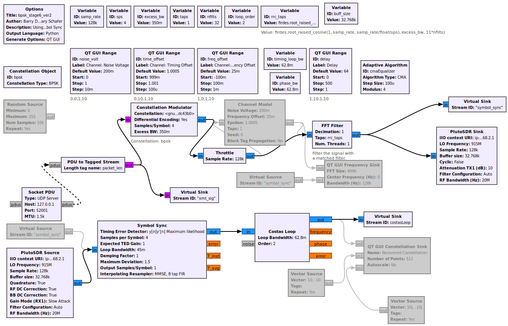
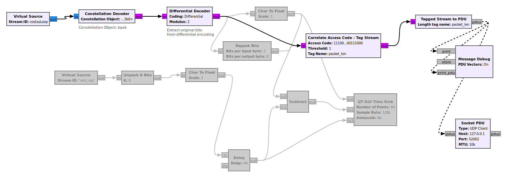
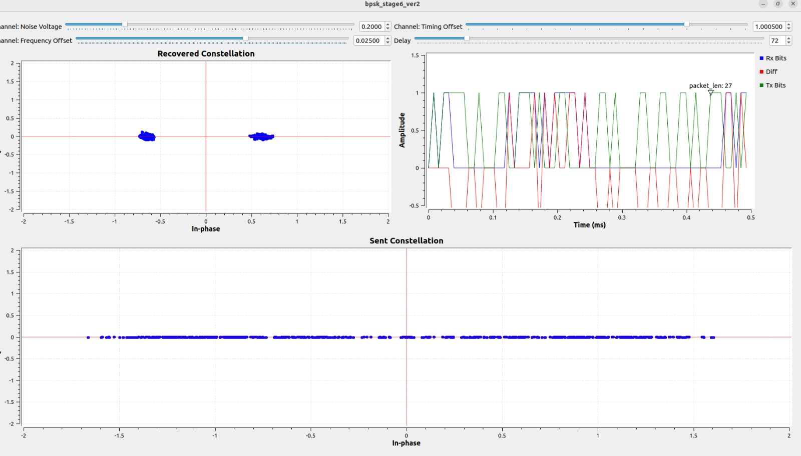

# TDMA-Swarm-Drones

Linux Layer-2 TAP (`sdr0`) to **ADALM-Pluto SDR** BPSK communication link built with **GNU Radio**. Routes live IP traffic (`ping`/UDP) over 915 MHz RF with unicast filtering, access-code framing, and packet/burst error logging.

```text
[Linux App / ping] ──► [sdr0 TAP] ──► [data_tap_transmit.py] ──(UDP 52001)──► [GNU Radio TX -> PlutoSDR]
                                                                                          │ (915 MHz RF)
[error_log.txt / data_arrival.txt] ◄── [rx_data_parse.py] ◄──(UDP 52002)── [GNU Radio RX <- PlutoSDR]
```

---

## Repository Files

| File | Purpose |
| :--- | :--- |
| `Bpsk_stage6_ver3_final.grc` | GNU Radio flowgraph (Differential BPSK TX/RX, `Symbol Sync`, `Costas Loop`, `Socket PDU` blocks). |
| `data_tap_transmit.py` | Captures unicast frames from `sdr0`, prepends sync header (`0xE546BA38` + length), and sends to UDP `52001`. |
| `rx_data_parse.py` | Receives unpacked bit-bytes from UDP `52002`, repacks into bytes, verifies sequences/CRC, and logs bursts. |
| `transmitter_graph.png` | TX chain and PlutoSDR Sink/Source block configuration. |
| `receiver_graph.png` | RX demodulation, access-code tagging, and UDP `52002` output wiring. |
| `constellations.jpeg` | Runtime QT GUI showing locked BPSK constellation and bit alignment. |

---

## GNU Radio Flowgraph Architecture

### Transmitter & PlutoSDR Front-End (`transmitter_graph.png`)


### Receiver Demodulation & PDU Output (`receiver_graph.png`)


---

## 1. Prerequisites & Hardware Setup

1. Connect the **ADALM-Pluto SDR** via USB (`ip:192.168.2.1`) with 915 MHz antennas attached.
2. Install dependencies on Ubuntu/Debian:
   ```bash
   sudo apt update
   sudo apt install -y gnuradio gr-iio libiio-utils python3 net-tools iproute2
   ```
3. Verify PlutoSDR connection:
   ```bash
   iio_info -u ip:192.168.2.1
   ```

---

## 2. Network Interface Setup (`sdr0`)

Create the virtual TAP interface, assign an IP, and add a static ARP entry (required because broadcast ARP packets are filtered out to keep the RF channel silent):

```bash
# Create and bring up TAP interface
sudo ip tuntap add dev sdr0 mode tap user $USER
sudo ip addr add 10.0.0.1/24 dev sdr0
sudo ip link set dev sdr0 up

# Add static ARP entry for target node
sudo arp -s 10.0.0.2 00:11:22:33:44:55 -i sdr0
```

---

## 3. Running the System

Open **4 terminals** in the repository folder and run the components in order:

### Terminal 1: Start GNU Radio Flowgraph
```bash
gnuradio-companion Bpsk_stage6_ver3_final.grc
```
Press **F5** (Generate) and **F6** (Execute).

**Active Flowgraph Parameters:**
* **LO Frequency:** `915 MHz` | **Sample Rate:** `128k` (`sps = 4`)
* **Pluto Buffer Size:** `32.768k` | **Access Code:** `0xE546BA38` (`packet_len`)
* **TX Socket PDU:** `UDP Server` at `127.0.0.1:52001`
* **RX Socket PDU:** `UDP Client` at `127.0.0.1:52002`

### Terminal 2: Start RX Parser & Logger
```bash
python3 rx_data_parse.py
```

### Terminal 3: Start TAP-to-UDP Transmitter
```bash
sudo python3 data_tap_transmit.py
```

### Terminal 4: Transmit Test Traffic
```bash
# Standard 1 Hz ping
ping 10.0.0.2

# Burst test (10 packets/sec)
ping -i 0.1 10.0.0.2
```

---

## 4. Results & Logs

### Runtime Constellation & Bit Alignment (`constellations.jpeg`)


* **QT GUI (`constellations.jpeg`):** Recovered constellation shows two tight BPSK clusters on the real axis ($\approx \pm 0.6$).
* **Terminal 2 Output:** Displays live packet count, sequence numbers, inter-arrival delta (`ms`), and link error percentage.
* **`data_arrival.txt`:** Logs each burst's start/end time, duration (`ms`), packet count, and sequence range.
* **`error_log.txt`:** Records any missing sequence numbers or corrupted frames with timestamps and raw hex headers.

---

## 5. Quick Troubleshooting

* **Nothing prints in `rx_data_parse.py`:** Ensure `Socket PDU` (`52002`) is wired directly to `Tagged Stream to PDU` (`pdus` port) in parallel with `Message Debug`, not after it.
* **Tail-end packet corruption:** Keep 8–16 trailing pad bytes (`0x55`) appended after the payload on TX (excluded from the `packet_len` header tag) and keep Pluto buffer size at `32.768k` or `16.384k`.
* **Scattered constellation points on desk tests:** Switch `PlutoSDR Source` Gain Mode to `Manual` (`30–40 dB`) and increase `PlutoSDR Sink` TX Attenuation to `20–30 dB`.
